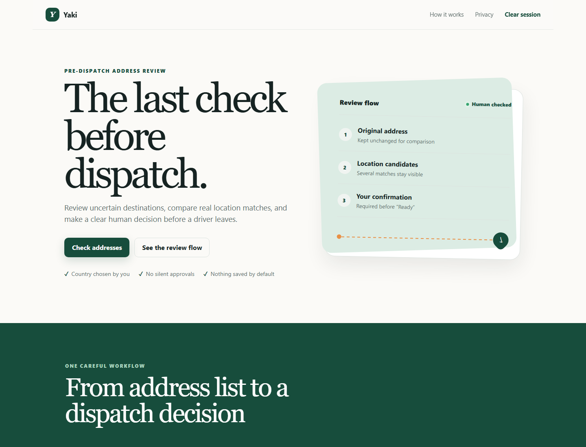
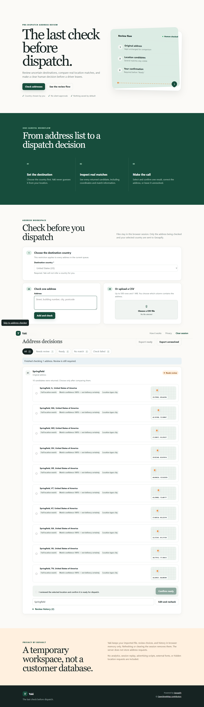
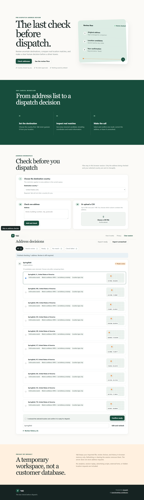
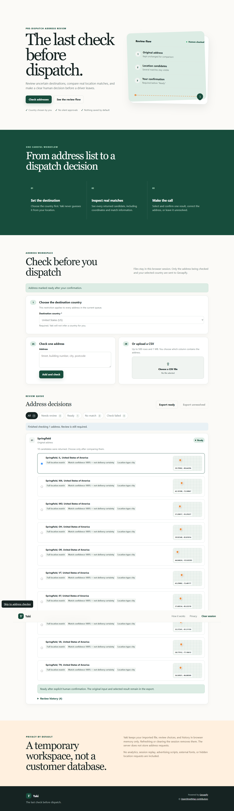
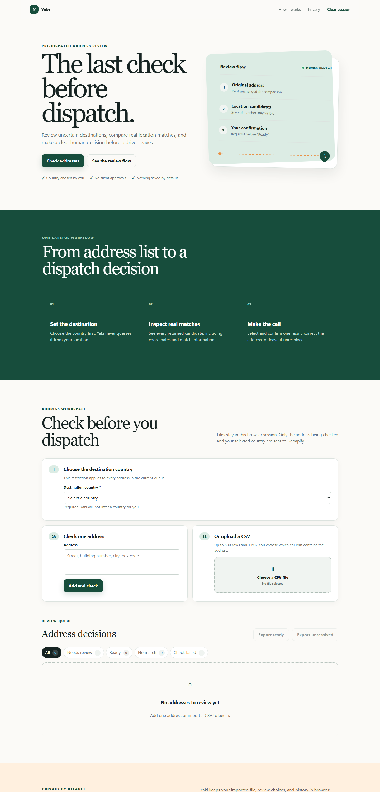

# Which Springfield? Building Yaki, the Last Check Before Dispatch

Type `Springfield` into a geocoder and you can get several technically correct answers. That is useful location evidence, but it is not yet a dispatch decision. A sender may mean Springfield, Illinois; Massachusetts; Missouri; Ohio; Oregon; or somewhere else entirely. Coordinates and a high confidence score cannot tell us which one was intended.

That gap is the reason I built **Yaki**, a visual address-review application for delivery coordinators. Yaki retrieves candidates from [Geoapify](https://www.geoapify.com/), keeps ambiguous results visible, and requires a person to select and explicitly confirm a destination before it can enter the ready export.

- [Public repository](https://github.com/YakiUdoph/Yaki)
- [Live application](https://yaki-seven.vercel.app/)
- [Reproducible walkthrough](demo-walkthrough.md)

This article separates three kinds of evidence:

- **VERIFIED** means source code, a tracked test, a saved sanitized artifact, or Git history supports the statement.
- **USER-REPORTED** means the project owner observed it, but this repository does not contain an independently reproducible artifact for that exact event.
- **UNKNOWN** means the available evidence cannot establish it.

That distinction matters in a tutorial about uncertain data.

## The operational problem behind a correct match

Geocoding answers a geographic question: “Which known locations plausibly match this text?” Dispatch adds an operational question: “Which location did this sender mean, and are we prepared to act on it?”

Those questions diverge in ordinary cases:

- a place name exists in several states or countries;
- a street address resolves to both a venue and a venue inside it;
- a response omits country information;
- a candidate conflicts with the country chosen by the operator;
- a result has maximum match confidence but still lacks entrance or delivery-access evidence.

Yaki does not turn Geoapify confidence into a deliverability verdict. It preserves the evidence and asks a human to make the workflow decision.



*Figure 1 — VERIFIED screenshot from the tracked browser evidence. It shows Yaki's review-first framing, not a live provider response.*

## The Springfield experiment

The clearest example came from two saved experiments on October 18, 2026.

First, the direct API and MCP were asked about the unqualified text `Springfield` without equivalent explicit country context. The direct request returned no candidates in that run, while the MCP path returned five results centered on Vermont and New Hampshire. This did **not** prove that either path was more accurate. It showed that ambiguous text plus different implicit context is not a reproducible comparison.

The correction was to require an operator-selected country and apply the same restriction to both paths:

```text
Direct API: countrycodes=us
MCP:        country_codes: ["us"]
```

The saved country-policy artifact then recorded the same five city candidates in the same order on both paths:

| Candidate | Coordinates | Result type | Confidence | Match type |
| --- | ---: | --- | ---: | --- |
| Springfield, Illinois | 39.7990175, -89.6439575 | city | 1 | full_match |
| Springfield, Massachusetts | 42.1018764, -72.5886727 | city | 1 | full_match |
| Springfield, Missouri | 37.2081729, -93.2922715 | city | 1 | full_match |
| Springfield, Ohio | 39.9234046, -83.8101380 | city | 1 | full_match |
| Springfield, Oregon | 44.0462362, -123.0220289 | city | 1 | full_match |

Source: [`artifacts/country-policy-live-results.json`](../artifacts/country-policy-live-results.json).

Every candidate had confidence `1`. That is exactly why Yaki does not label confidence as “delivery certainty.” The evidence said that each candidate matched the query well; it did not say which state the sender had in mind. The policy correctly returned `review_required` with `multiple_candidates` and `human_confirmation_required`, and `readyForDispatch` remained `false`.

The project owner initially reported exercising the production UI, selecting Springfield, Illinois, checking the human-confirmation statement, and exporting a Ready CSV. That earlier observation remains **USER-REPORTED historical evidence** because no artifact captured that exact session.

### Independently captured production browser evidence

On October 21, 2026, a separate Phase 5C verification captured a later session against the public Yaki application. The browser made exactly one `POST /api/geocode` request for `Springfield` with country `US`; production returned HTTP `200` and ten candidates. The server policy was `review_required`, `readyForDispatch` was `false`, and every displayed candidate had 100% match confidence. The UI still required candidate selection and explicit confirmation before enabling a one-row Ready export. No second geocoding request or browser console error was observed.



*Figure 2 — VERIFIED production browser capture before selection. Ten candidates are visible, but none is automatically approved.*



*Figure 3 — VERIFIED production browser capture after selection and before human confirmation. Ready export remains unavailable.*



*Figure 4 — VERIFIED production browser capture after confirmation. Ready export is enabled.*

The sanitized [production evidence directory](../artifacts/production-verification-2026-10-21/README.md) contains:

1. a production browser screenshot of all candidates before selection;
2. Springfield, Illinois selected while the row is still awaiting confirmation;
3. the Ready state after explicit confirmation;
4. the downloaded Ready CSV; and
5. a separately identified local rendering of that CSV, which is not presented as a production-page screenshot.

The earlier saved direct/MCP experiment returned five candidates, while this later production response returned ten. That difference is expected provider variability and is why no future candidate count should be treated as permanent. This production session verifies one successful review/export path; clarification, candidate-change, no-result, and provider-error safeguards remain source/test-verified rather than production-verified by this session.

### International production acceptance check

On October 22, 2026, Phase 5E made four additional production requests—exactly one per selected country, with no retry. All four public landmarks completed the selection, explicit-confirmation, and Ready-export flow without a second geocoding request:

| Country and public query | HTTP | Candidates | Country-policy observation | Selected result | Outcome |
| --- | ---: | ---: | --- | --- | --- |
| Nigeria (`NG`): `National Theatre, Lagos` | 200 | 10 | All 10 carried `ng`; `review_required` | National Theatre, Lagos Badagry Expressway | **PASS** |
| United Kingdom (`GB`): `Buckingham Palace, London` | 200 | 10 | All 10 carried `gb`; `review_required` | Buckingham Palace, London, SW1A 1AA | **PASS** |
| Ghana (`GH`): `Independence Square, Accra` | 200 | 1 | Candidate carried `gh`; `review_required` | Black Star Square, Accra | **PASS** |
| Canada (`CA`): `CN Tower, Toronto` | 200 | 1 | Candidate carried `ca`; `review_required` | CN Tower, Toronto | **PASS** |

In every case, `readyForDispatch` was initially `false`, `human_confirmation_required` was present, Ready export stayed disabled before selection and confirmation, and the downloaded Ready CSV contained exactly one row with the selected country code. No browser console error was observed. The original screenshots, downloaded CSVs, machine-readable result, scope notes, and SHA-256 manifest are published in the [international production evidence directory](../artifacts/international-production-verification-2026-10-22/README.md).

The preserved Ready screenshots also expose a real presentation defect in that production session: the earlier blue completion banner still said “Review is still required” after the row became Ready. In the one-candidate Ghana and Canada cases, the card also retained “It still needs your confirmation.” Phase 5F corrected both strings to derive from the current record and existing server-policy state. Quota-free unit and mocked-browser regression tests verify the correction, candidate-change reset, and clarification block. Vercel later reported the correction commit READY, and a public GET confirmed that the alias serves the corrected `review-model.js`; no additional geocoding workflow was run, so the pre-fix screenshots themselves do not prove the corrected interaction.

This is evidence for four successful public-landmark workflows at one point in time. It does not establish general international coverage, postal deliverability, future rankings, or production behavior for clarification, no-result, and provider-error cases.

## What Yaki does

Yaki supports one address or a local CSV import. The browser validates and previews the CSV, the operator chooses the address column and destination country, and rows are checked sequentially. Each result remains one of four states:

- **Needs review** — candidates exist, but a person has not completed selection and confirmation.
- **Ready** — an eligible candidate was selected and explicitly confirmed.
- **No match** — the provider returned a successful zero-candidate response.
- **Check failed** — configuration, transport, rate-limit, or provider work failed; Yaki does not mislabel this as an invalid address.

The Ready and Unresolved exports are separate. Both preserve the original address, reviewed address, selected result where applicable, coordinates, country, latest action, and timestamp. Spreadsheet-formula prefixes are neutralized before export.



*Figure 5 — VERIFIED empty-workspace capture. It documents the interface, not a live geocoding outcome.*

## Architecture: direct API in production, MCP in the experiment

The shipped application is deliberately small:

```text
Browser workspace
    │ POST /api/geocode { address, countryCode }
    ▼
Local Node server or Vercel Function
    │ validates input, origin, size, and rate limit
    ▼
Geoapify Forward Geocoding API
    │ x-api-key header + explicit countrycodes restriction
    ▼
Candidate evidence + server policy
    │
    ▼
Human selection and confirmation in browser memory
    │
    ├── Ready CSV
    └── Unresolved CSV
```

The production path performs one logical direct Forward Geocoding lookup per address, with a bounded retry only for retryable failures:

```http
GET https://api.geoapify.com/v1/geocode/search
    ?text=Springfield
    &format=json
    &limit=10
    &lang=en
    &bias=countrycode:none
    &countrycodes=us
X-API-Key: supplied-server-side
```

The exact URL is assembled in [`src/geoapify.ts`](../src/geoapify.ts). The API key comes from `GEOAPIFY_API_KEY`, is sent in the `x-api-key` header, and never needs to enter browser JavaScript or a query string. The browser calls only same-origin `/api/geocode`.

The application normalizes and retains useful candidate fields including formatted address, address lines, longitude, latitude, `place_id`, result type, components, rank confidence fields, and match type. Parsed-query evidence is retained when the direct API returns it.

### Why not use Geoapify's asynchronous Batch API here?

Geoapify documents dedicated and generic batch endpoints for up to 1,000 inputs. They are valuable for bulk normalization and asynchronous workloads. Yaki's current CSV workflow instead sends rows sequentially because its product requirement is to retain several candidates per row for interactive review, keep the implementation inspectable, and avoid introducing job polling and temporary-result recovery into this version.

That is a limitation, not a claim that sequential calls are universally better. A future durable, high-volume Yaki would need row identity, resumable jobs, idempotency, bounded polling, and storage for reviewed decisions. The [capability assessment](geoapify-capabilities.md) documents the trade-off.

## Country policy and human confirmation

The country selector is not a cosmetic filter. Yaki sends the operator's two-letter code as the direct API's `countrycodes` restriction. The policy does not infer country from an IP address, the first result, coordinates, or provider ranking.

The server policy has three statuses:

- `clarification_required` when country context is missing, no candidates exist, or candidate country evidence is missing or conflicts with the selected country;
- `review_required` when evidence exists but human selection and confirmation are incomplete;
- `ready` only when the selected candidate exists in preserved evidence and a human explicitly confirms it.

The browser preserves that server decision. A Phase 5A audit found that the earlier browser model checked candidate selection and the confirmation checkbox but did not also gate confirmation and export on `policy.status`. Commit `1ec5929` corrected both boundaries:

- clarification-required rows no longer expose confirmation controls;
- confirmation throws a simple policy reason if called anyway;
- Ready export independently excludes blocked records;
- changing the selected candidate revokes Ready and requires confirmation again.

Regression tests cover missing candidate country, country mismatch, clarification-required responses, valid confirmation, blocked export, missing selection, missing human confirmation, and candidate changes. This reused the existing policy contract rather than inventing a browser-side country policy.

## A second useful ambiguity: one address, two amenities

The saved live application artifact contains another instructive case: `200 Larkin Street, San Francisco, CA 94102, United States` returned two candidates in the recorded run:

1. Asian Art Museum of San Francisco.
2. Asian Art Museum Cafe.

Both were at the same street address, both had confidence `1`, and both had `inner_part` match type. The server returned `needs_review`; policy reasons were `multiple_candidates` and `human_confirmation_required`. This is strong evidence that geocoding confidence and operational intent are different concepts even when the street address itself looks complete.

The sanitized result is in [`artifacts/app-live-e2e-results.json`](../artifacts/app-live-e2e-results.json). It was a local application-to-Geoapify run, not a production deployment test.

## AI-assisted development: what is and is not preserved

Batch #2 asks participants to explain their AI workflow. The repository preserves the engineering outputs: an experiment plan, OpenAPI capability notes, typed direct/MCP clients, mocked contract tests, live sanitized artifacts, browser evidence, failure reports, and focused commits. It does **not** preserve historical Codex chat transcripts, exact prompts, agent configuration, or a complete tool-call trace.

Therefore:

- **VERIFIED:** Geoapify OpenAPI contracts and documentation informed the client constraints and tests recorded in the repository.
- **VERIFIED:** the repository contains executable direct API and MCP harnesses plus saved results.
- **VERIFIED:** Git history records focused corrections, including Vercel module exports and policy-safe browser confirmation.
- **UNKNOWN:** the exact wording and sequence of historical coding-assistant prompts used before those commits.

No reconstructed prompt below is presented as history.

### Present-day reproducible example prompt — not historical

A reader could give a coding assistant the repository and the Forward Geocoding OpenAPI specification, then use a prompt like this:

```text
Review the existing Yaki Geoapify client and the official Forward Geocoding
OpenAPI contract. Do not redesign the application. Verify input limits,
countrycodes serialization, candidate response fields, x-api-key handling,
error classification, and the rule that confidence must not auto-approve a
delivery. Add mocked contract tests before changing runtime code. Keep all
credentials server-side and report any contract ambiguity instead of guessing.
```

This is a current reproducibility aid written for this tutorial. It is not an authentic transcript from the original implementation.

A useful AI workflow for this repository is evidence-first:

1. Give the assistant the relevant OpenAPI specification and existing code.
2. Ask it to enumerate contract assumptions before editing.
3. Require mocked tests for serialization, response normalization, and each error layer.
4. Use a tiny set of public-address live calls only after mocked tests pass.
5. Save sanitized outcomes and clearly distinguish mocks, local live calls, production checks, and user reports.
6. Have a human review product language and every transition to Ready.

## What the MCP experiment actually did

Yaki's production application does not contain an LLM and does not call MCP for each address. MCP was a separate development experiment at `POST https://api.geoapify.com/v1/mcp` using JSON-RPC and protocol version `2025-06-18`.

The saved live artifact records `tools/list` discovery of 11 tools:

```text
geocode_address
geocode_structured_address
reverse_geocode_coordinates
search_places
list_place_categories
calculate_route
calculate_route_matrix
combine_geometries
evaluate_spatial_relation
measure_geometry
transform_geometry
```

The experiment then called `geocode_address` through `tools/call`. Focused authentication checks reported success for `x-api-key`, `Authorization: ApiKey ...`, and query `apiKey` in that dated run. Yaki still prefers `x-api-key` because it avoids putting a credential in the URL.

The MCP client explicitly distinguishes:

- non-successful HTTP responses;
- a top-level JSON-RPC `error`;
- HTTP 200 with `result.isError: true`.

Treating every HTTP 200 as success would have been a real contract bug.

### Direct API versus MCP

| Question | Direct API | MCP experiment |
| --- | --- | --- |
| Shipped in the application path? | Yes | No |
| Main address action | `GET /v1/geocode/search` | `tools/call` → `geocode_address` |
| Country input | `countrycodes=us` | `country_codes: ["us"]` |
| Candidate limit in Yaki harness | Up to 100 by contract; app requests 10 | Up to 10 |
| Parsed-query evidence observed | Yes | No |
| Runtime tool discovery | No | Yes, through `tools/list` |
| Separate deliverability verdict | No | No |

MCP was useful for discovery and a traceable comparison, but it did not add an independent address-verification truth source. The direct API retained richer evidence and offered the simpler deterministic production path.

## Failures and corrections worth keeping in the story

Good integration work is not a sequence of uninterrupted successes. Yaki's evidence records several useful failures.

### 1. Unequal country context made Springfield comparisons misleading

**Observed symptom:** direct and MCP results differed for the unqualified query.

**Confirmed correction:** require an operator-selected country and pass equivalent restrictions to both paths. The focused run then produced the same five candidates, but still required human review.

**Lesson:** make hidden geographic context explicit before comparing rankers.

### 2. Vercel function exports did not match the platform runtime

Commit `ed4fd39` replaced a default object with named `POST`, `GET`, and `HEAD` exports and added browser-facing diagnostics for non-JSON platform errors.

**Confirmed root cause:** the function module shape was incompatible with the expected Vercel handler exports.

**Lesson:** a local HTTP server test does not prove that a serverless platform can load the module. Keep platform contract tests separate.

### 3. Browser confirmation could outrun server policy

**Confirmed root cause:** browser confirmation and export trusted local selection/checkbox/status without enforcing the received `clarification_required` status.

**Confirmed correction:** commit `1ec5929` gates controls, mutation, and export on the existing server policy and adds regression/browser tests.

**Lesson:** safety decisions returned by the server must survive every client-side transition and every export boundary.

### 4. Ready-state informational copy went stale

**Confirmed root cause:** the completion banner was written only when the geocoding batch ended, while the candidate-card introduction depended only on candidate count. Neither message derived from the later confirmation state.

**Confirmed correction:** Phase 5F now derives both messages from the existing browser review record and policy contract. Before confirmation they ask for review; after eligible confirmation they describe Ready; changing the candidate restores review copy; and `clarification_required` can never produce Ready copy.

**Lesson:** informational text is part of the state model. A correct badge and export gate do not excuse contradictory guidance elsewhere on the same screen.

### 5. A credentialed live check later failed at the network boundary

**USER-REPORTED historical observation:** during Phase 5A on October 21, the one-address credentialed test was attempted twice and returned Yaki's safe `502` network classification both times. No successful response was claimed, and the quota-free checks remained green. No standalone repository artifact preserves those two attempts.

**Observed symptom:** upstream work did not complete within the available environment.

**UNKNOWN:** the evidence did not isolate DNS, egress, provider availability, or another network cause.

**Lesson:** retain typed network failure, never reinterpret it as “address invalid,” and never use unit-test success as deployment evidence.

### 6. Browser evidence exposed unrelated extension content

A prior screenshot contained a Gata browser-extension panel. A clean-profile audit found no matching source, iframe, wallet global, external request, or post-footer element in Yaki; the installed extension bundle contained the distinctive text and had all-URL scripting scope.

**Lesson:** capture release evidence in an isolated, extension-disabled profile and record the network boundary.

## Reproduce Yaki locally

Requirements:

- Node.js 22.18 or later;
- PowerShell for the commands below;
- a Geoapify key authorized for Geocoding API use only when running live checks.

**USER-REPORTED program context:** the organizer supplied a Geoapify free-plan key for the deployed project. The value is intentionally absent from this repository and article. Vercel provides it only as the sensitive server-side `GEOAPIFY_API_KEY`; readers must use their own authorized key for local live checks.

```powershell
git clone https://github.com/YakiUdoph/Yaki.git
Set-Location Yaki
npm.cmd ci
Copy-Item .env.example .env
```

Edit `.env` locally:

```dotenv
GEOAPIFY_API_KEY=replace_with_your_own_key
YAKI_PORT=4173
```

Do not commit `.env`. Start the application:

```powershell
npm.cmd start
```

Open `http://127.0.0.1:4173`. For restart-on-change development, run `npm.cmd run dev`.

### Test commands

```powershell
# TypeScript, no provider quota
npm.cmd run typecheck

# Unit, HTTP, policy, CSV, and Vercel contract suite.
# The credentialed live case is skipped unless GEOAPIFY_API_KEY is already
# loaded in this shell. If it is loaded, npm test consumes one provider request.
npm.cmd test

# Focused Vercel Function contracts, no provider quota
npm.cmd run test:vercel

# Real Chrome or Edge interaction with an explicit mock, no provider quota
npm.cmd run test:browser

# Clean-profile visual/security audit with an explicit mock
npm.cmd run test:security

# One real public Springfield request; requires .env and consumes quota
npm.cmd run test:vercel-live

# Two real public-address checks through the application path; consumes quota
npm.cmd run test:app-live
```

Without `GEOAPIFY_API_KEY`, the live Vercel-handler case inside `npm.cmd test` is expected to report one skip. Mocked browser success must not be described as a live Geoapify result.

To target the public application explicitly:

```powershell
$env:YAKI_BASE_URL="https://yaki-seven.vercel.app"
npm.cmd run test:app-live
```

Run this only when an authorized key/environment is configured and a fresh live check is actually intended.

## Security, privacy, and product limits

Yaki parses CSV files locally and sends only the current address and chosen country to its same-origin API. Queue data and review history stay in browser memory; there is no database, account system, cookie, analytics package, external font, or map-tile request in the current application.

The server validates request method, content type, body size, address/country shape, and cross-site browser context. It applies a bounded in-memory rate limiter, upstream timeout, safe public errors, and no-store/security headers. CSV exports neutralize common spreadsheet-formula prefixes.

Important limits remain:

- Geoapify necessarily receives the checked address, selected country, and ordinary network metadata.
- There is no authentication, multi-user isolation, or durable review/audit store.
- The serverless in-memory limiter is not a globally consistent production limit.
- Yaki does not verify entrances, access restrictions, postal deliverability, or driver safety.
- Provider data and rankings can change.
- Formal accessibility, privacy/legal, monitoring, and sustained-traffic reviews remain incomplete.
- Real customer addresses should not be used until the relevant policies and controls are approved.

## What worked, what did not, and what I would improve

What worked well:

- Geoapify returned multiple structured candidates instead of forcing a silent first result.
- The explicit `countrycodes` restriction made the Springfield experiment reproducible for one recorded US case.
- Direct responses preserved parsed-query and detailed candidate evidence useful for review.
- MCP tool discovery made the available geospatial surface inspectable at runtime.
- Contract tests caught distinctions between HTTP, JSON-RPC, and tool-level errors.

What did not work automatically:

- confidence did not resolve human intent;
- unqualified ambiguous queries were not comparable across paths with different context;
- MCP did not provide an independent deliverability verdict;
- local success did not guarantee Vercel module compatibility or external network availability;
- the browser initially failed to preserve one server policy boundary.

Constructive tooling feedback:

1. Make the preferred MCP authentication method and security trade-offs prominent and consistent across human docs and machine-readable material.
2. Clarify whether MCP geocoding uses the same ranking configuration as direct v1 geocoding and how implicit location bias is controlled.
3. Expose parsed-query evidence through MCP, or explicitly document why it is omitted.
4. Clarify empty-input behavior for structured geocoding and identify the canonical confidence field when top-level and rank values coexist.
5. Provide a documented MCP batch-address tool or a direct guide explaining when agents should choose Generic Batch versus paced direct calls.
6. Add more executable examples that demonstrate HTTP 200 plus `result.isError: true` so client authors do not mistake it for success.

Potential Yaki improvements include a distributed rate limiter, authentication and role separation, durable but privacy-reviewed audit history, resumable large imports, and accessibility testing with assistive technology. None of those are claimed as current functionality.

## Final lesson

The important result was not that Geoapify found five Springfields. It was that all five could be plausible, all five could have confidence `1`, and the software still refused to guess.

Geocoding supplied the evidence. The country policy made the comparison safer. The person supplied intent. Yaki's job was to keep those responsibilities separate until the last check before dispatch.

## Evidence index

- Springfield direct/MCP country-restricted evidence: [`artifacts/country-policy-live-results.json`](../artifacts/country-policy-live-results.json)
- Earlier paired direct/MCP evidence: [`artifacts/live-contract-results.json`](../artifacts/live-contract-results.json)
- Two-address local live application evidence: [`artifacts/app-live-e2e-results.json`](../artifacts/app-live-e2e-results.json)
- One-request production Springfield browser evidence: [`artifacts/production-verification-2026-10-21/`](../artifacts/production-verification-2026-10-21/README.md)
- Phase 5A browser regression evidence: [`artifacts/browser-e2e-results.json`](../artifacts/browser-e2e-results.json)
- Clean-profile browser/security evidence: [`artifacts/visual-security-audit.json`](../artifacts/visual-security-audit.json)
- Direct/MCP findings: [Phase 2 live report](live-contract-report.md) and [MCP feasibility](mcp-feasibility.md)
- Location policy: [Location-context policy](location-context-policy.md)
- Architecture and privacy boundary: [Architecture](architecture.md)
- Historical testing and failures: [Phase 3 report](phase3-test-report.md), [Phase 3B audit](phase3b-visual-security-audit.md), and [historical Phase 4 release report](phase4-release-report.md)
